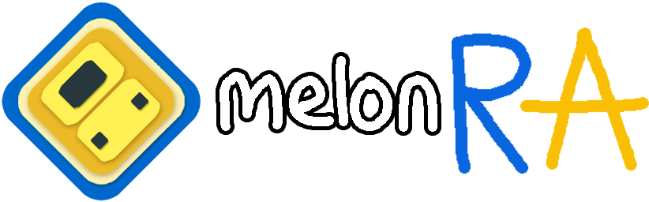

<p align="center"></p>
<h3 align="center">melonRA - fork of melonDS with RetroAchievements integration and other neat features</h3>
<p align="center">
<a href="https://retroachievements.org"></a>
<a href="https://github.com/melonDS-emu/melonDS"></a>
<a href="https://www.gnu.org/licenses/gpl-3.0"></a>
<br>
<a href="https://github.com/ppkkkkk/melonRA/actions/workflows/build-windows.yml"></a>
<a href="https://github.com/ppkkkkk/melonRA/actions/workflows/build-ubuntu.yml"></a>
<a href="https://github.com/ppkkkkk/melonRA/actions/workflows/build-macos.yml"></a>
<a href="https://github.com/ppkkkkk/melonRA/actions/workflows/build-bsd.yml"></a>
</p>

melonRA is [melonDS](https://github.com/melonDS-emu/melonDS), the Nintendo DS/DSi emulator, with
[RetroAchievements](https://retroachievements.org) built in. Log in, load a game, and earn achievements,
compete on leaderboards and show off your progress on your RetroAchievements profile, all from the
regular melonDS desktop app.

## Features

- **RetroAchievements**
  - log in once with your password; only a login token is kept, never the password itself
  - automatic game detection, hardcore mode **(WIP)**, subsets, encore, spectator and unofficial achievements
  - play offline, in Hardcore or Casual: games played online once keep their achievements, unlocks are sent later
  - notifications, challenge and progress indicators, leaderboard trackers in a customisable overlay
- **Game list** with icons, region flags, search and sorting, a grid view with box art, and achievement progress bars with stars for mastered games
- **Screen hotkeys** to cycle through layouts and sizings, and to rotate the screens, while playing
- **Settings backup and restore** in one file, for moving to another computer
- **Game Settings** per game (graphics, layout, Wi-Fi, emulation, cheats), from the game list
- **Online play server picker** (Wiimmfi, Kaeru WFC or a custom DNS) in Wi-Fi Settings
- **Built-in updater** with Stable and Nightly channels

## Getting started

1. Download the [latest release](https://github.com/ppkkkkk/melonRA/releases/latest):
   `melonRA-<version>-windows-x86_64.zip` for Windows, or the Linux AppImage. Unzip it anywhere and run
   `melonRA.exe`. To try the newest changes before a release, use the
   [nightly build](https://github.com/ppkkkkk/melonRA/releases/tag/nightly) (Windows and Linux),
   or build it yourself (see below).
2. Set up melonDS as usual (BIOS/firmware are optional, see the original README below).
   Click **Add Folder...** on the main screen (or the **Game folders** list in **Config → Path Settings**) to list your
   games there.
3. Open **RetroAchievements → Log In…** and sign in with your
   [RetroAchievements.org](https://retroachievements.org) account.
4. Load a game. A popup shows the game and your progress. **RetroAchievements → Achievements…** opens
   the full list and the leaderboards.

All options live in **RetroAchievements → Settings…**: hardcore, encore, spectator, unofficial
achievements, which notifications to show, and sounds. Its **Appearance** tab sets where each
notification goes and how it looks.

## Versions

melonRA versions are `MAJOR.MINOR.PATCH`, starting at 0.1.0:

- **MAJOR** goes up for major releases.
- **MINOR** goes up for feature releases.
- **PATCH** goes up for small updates and fixes.

What changed in each version is in [CHANGELOG.md](./CHANGELOG.md).

## Updates

When a new version is out, melonRA asks whether to update now, skip that version, or wait until next
time. **Config → Update Settings** has the rest:

- **Update Channel:** *Stable* follows the releases. *Nightly* follows the
  [nightly build](https://github.com/ppkkkkk/melonRA/releases/tag/nightly), a new build for every
  change.
- **Always update to the latest version** downloads and installs updates on startup, before melonRA opens.
- **Never ask about updates** stops the check at startup. You can still check from the same window.

melonRA updates itself on Windows and when run as the Linux AppImage. On macOS, or a Linux build installed
another way, it tells you about new versions and links to the download.

## Building

melonRA builds exactly like melonDS. The RetroAchievements library (rcheevos) is included in the source
tree, so there are **no extra dependencies**.

### Windows (MSYS2)

1. Install [MSYS2](https://www.msys2.org/) and open the **MSYS2 UCRT64** terminal.
2. Update with `pacman -Syu` (reopen the terminal if it asks).
3. Install the tools and dependencies:
   ```bash
   pacman -S git mingw-w64-ucrt-x86_64-{toolchain,cmake,SDL2,libarchive,enet,zstd,faad2,qt6-base,qt6-svg,qt6-multimedia,qt6-tools}
   ```
4. Clone and build:
   ```bash
   git clone https://github.com/ppkkkkk/melonRA
   cd melonRA
   cmake -B build
   cmake --build build
   ```
5. Run `build/melonRA.exe` from the same terminal, so it can find the DLLs.

### Linux

Install the same dependencies as for melonDS. On Ubuntu 24.04:

```bash
sudo apt install cmake extra-cmake-modules libcurl4-gnutls-dev libpcap0.8-dev libsdl2-dev libarchive-dev \
  libenet-dev libzstd-dev libfaad-dev qt6-{base,base-private,multimedia,svg}-dev
git clone https://github.com/ppkkkkk/melonRA
cd melonRA
cmake -B build
cmake --build build -j$(nproc --all)
```

### macOS

```zsh
brew install git pkg-config cmake sdl2 qt@6 libarchive enet zstd faad2
git clone https://github.com/ppkkkkk/melonRA
cd melonRA
cmake -B build -DCMAKE_PREFIX_PATH="$(brew --prefix qt@6);$(brew --prefix libarchive)"
cmake --build build -j$(sysctl -n hw.logicalcpu)
```

For other platforms, Nix and static builds, see [BUILD.md](./BUILD.md).

### Optional: RAIntegration (Windows)

For achievement developers:

1. Enable *Load the RAIntegration developer toolkit* in **RetroAchievements → Settings…**.
2. Click **Download / update RAIntegration**. melonRA fetches the latest `RA_Integration-x64.dll` from
   retroachievements.org and puts it next to `melonRA.exe`. You can also place the DLL there yourself.
3. Restart melonRA. The toolkit appears under **RetroAchievements → Developer Toolkit**.

melonRA also offers to download the DLL at startup if it is missing or older than the minimum version
RetroAchievements requires. The toolkit is available on x64 (and x86) Windows only; it has no ARM64 build.

## For developers

The RetroAchievements code is in `src/frontend/qt_sdl/RetroAchievements/`, and the vendored rcheevos library
is in `src/rcheevos/`. [RETROACHIEVEMENTS.md](./RETROACHIEVEMENTS.md) covers:

- how the pieces fit together and where melonDS is hooked
- the DS memory map and the savestate format
- the offline unlock queue
- the hardcore compliance checklist

[NETPLAY.md](./NETPLAY.md) explains how netplay keeps every computer's consoles identical, its network
protocol and the security rules any change to it has to keep.

## Privacy and licenses

melonRA has no telemetry. It only talks to RetroAchievements.org (when you're logged in), GitHub (update checks)
and GameTDB and libretro (box art, if you allow it). See [PRIVACY.md](./PRIVACY.md). Bundled and linked components are listed in [THIRD-PARTY-LICENSES.md](./THIRD-PARTY-LICENSES.md).

## Credits

melonRA is built on the work of these projects:

- [melonDS](https://github.com/melonDS-emu/melonDS) by Arisotura and the melonDS team, which is all the actual emulation
- [RetroAchievements](https://retroachievements.org), [rcheevos](https://github.com/RetroAchievements/rcheevos) and
  [RAIntegration](https://github.com/RetroAchievements/RAIntegration)
- [Qt](https://www.qt.io) and [SDL](https://www.libsdl.org)
- [teakra](https://github.com/wwylele/teakra), [Dolphin](https://github.com/dolphin-emu/dolphin) (JIT emitter),
  [DuckStation](https://github.com/stenzek/duckstation) (OpenGL context code), [libslirp](https://gitlab.freedesktop.org/slirp/libslirp),
  [FatFs](http://elm-chan.org/fsw/ff/), [blip-buf](https://code.google.com/archive/p/blip-buf/),
  [toml11](https://github.com/ToruNiina/toml11), [glad](https://github.com/Dav1dde/glad), [gif-h](https://github.com/charlietangora/gif-h),
  [tiny-AES-c](https://github.com/kokke/tiny-AES-c), [xxHash](https://github.com/Cyan4973/xxHash),
  [libarchive](https://www.libarchive.org), [zstd](https://github.com/facebook/zstd), [FAAD2](https://github.com/knik0/faad2)
  and [ENet](http://enet.bespin.org)
- [famfamfam flag icons](http://www.famfamfam.com/lab/icons/flags/) and [flag-icons](https://github.com/lipis/flag-icons) by lipis
- [Lucide](https://lucide.dev) icons in the Settings window
- Box art from [GameTDB](https://www.gametdb.com) and the [libretro thumbnails](https://github.com/libretro-thumbnails/libretro-thumbnails)
- Ideas borrowed from [DuckStation](https://github.com/stenzek/duckstation), [Dolphin](https://github.com/dolphin-emu/dolphin),
  [RetroArch](https://github.com/libretro/RetroArch) and WatermelonDS

melonRA is free software under the GPLv3, like melonDS. It is not affiliated with the melonDS team or RetroAchievements.
Licenses for everything above are in [THIRD-PARTY-LICENSES.md](./THIRD-PARTY-LICENSES.md).

## Ethos on AI Usage

I am not a developer with much finesse, but new technologies make it easier every day to mold things in a direction that you'd like them to.
I don't think developing stuff with the help of AI is inherently bad, but there are a slew of people who only really care about the end result
and not forging a more polished product, I can at least say I polish up on visuals and stuff that AI could never replace to a T,
my end goal is to have a temporary solution until something better comes along the way, hopefully taking into account what AI was able to come
up with in this or any other repository, Pandora's Box has already opened... Why not take advantage of it?

<br>
<hr>
<hr>
<br>

# Original melonDS README

<p align="center"></p>
<h2 align="center"><b>melonDS</b></h2>
<p align="center">
<a href="http://melonds.kuribo64.net/" alt="melonDS website"></a>
<a href="http://melonds.kuribo64.net/downloads.php" alt="Release: 1.1"></a>
<a href="https://www.gnu.org/licenses/gpl-3.0" alt="License: GPLv3"></a>
<a href="https://kiwiirc.com/client/irc.badnik.net/?nick=IRC-Source_?#melonds" alt="IRC channel: #melonds"></a>
<a href="https://discord.gg/pAMAtExcqV" alt="Discord"></a>
<br>
<a href="https://github.com/melonDS-emu/melonDS/actions/workflows/build-windows.yml?query=event%3Apush"></a>
<a href="https://github.com/melonDS-emu/melonDS/actions/workflows/build-ubuntu.yml?query=event%3Apush"></a>
<a href="https://github.com/melonDS-emu/melonDS/actions/workflows/build-macos.yml?query=event%3Apush"></a>
<a href="https://github.com/melonDS-emu/melonDS/actions/workflows/build-bsd.yml?query=event%3Apush"></a>
</p>
DS emulator, sorta

The goal is to do things right and fast, akin to blargSNES (but hopefully better). But also to, you know, have a fun challenge :)
<hr>

## How to use

Firmware boot (not direct boot) requires a BIOS/firmware dump from an original DS or DS Lite.
DS firmwares dumped from a DSi or 3DS aren't bootable and only contain configuration data, thus they are only suitable when booting games directly.

### Possible firmware sizes

 * 128KB: DSi/3DS DS-mode firmware (reduced size due to lacking bootcode)
 * 256KB: regular DS firmware
 * 512KB: iQue DS firmware

DS BIOS dumps from a DSi or 3DS can be used with no compatibility issues. DSi BIOS dumps (in DSi mode) are not compatible. Or maybe they are. I don't know.

As for the rest, the interface should be pretty straightforward. If you have a question, don't hesitate to ask, though!

## How to build
See [BUILD.md](./BUILD.md) for build instructions.

## TODO LIST

 * better DSi emulation
 * better OpenGL rendering
 * netplay
 * the impossible quest of pixel-perfect 3D graphics
 * support for rendering screens to separate windows
 * emulating some fancy addons
 * other non-core shit (debugger, graphics viewers, etc)

### TODO LIST FOR LATER (low priority)

 * big-endian compatibility (Wii, etc)
 * LCD refresh time (used by some games for blending effects)
 * any feature you can eventually ask for that isn't outright stupid

## Credits

 * Martin for GBAtek, a good piece of documentation
 * Cydrak for the extra 3D GPU research
 * limittox for the icon
 * All of you comrades who have been testing melonDS, reporting issues, suggesting shit, etc

## Licenses

[](http://www.gnu.org/licenses/gpl-3.0.en.html)

melonDS is free software: you can redistribute it and/or modify
it under the terms of the GNU General Public License as published by
the Free Software Foundation, either version 3 of the License, or
(at your option) any later version.

### External
* Images used in the Input Config Dialog - see `src/frontend/qt_sdl/InputConfig/resources/LICENSE.md`
